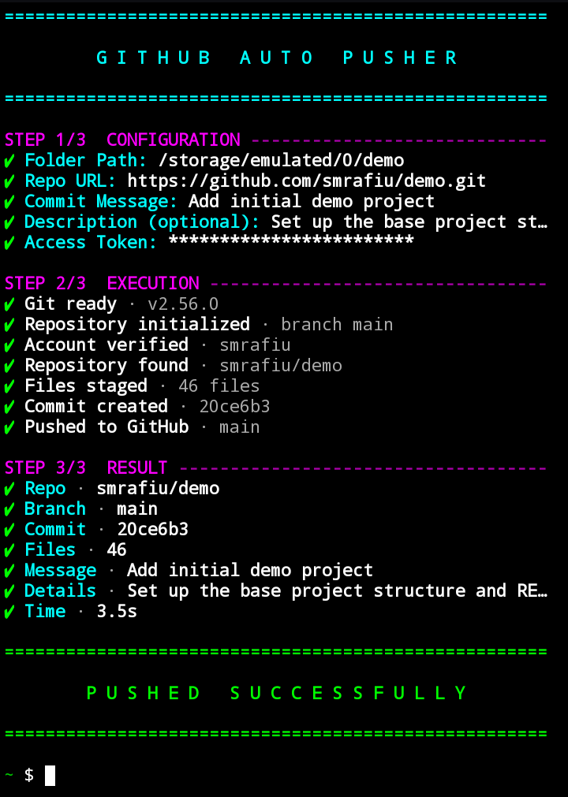
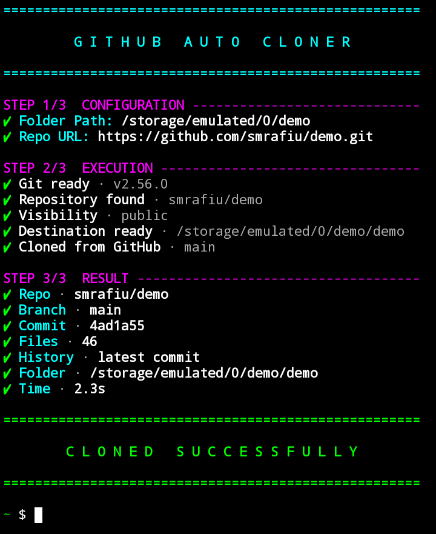
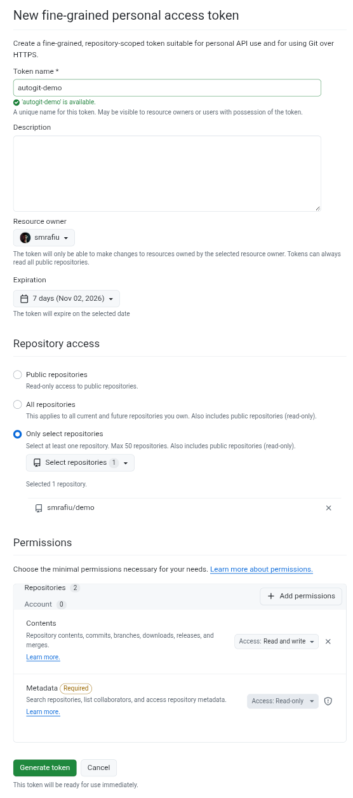
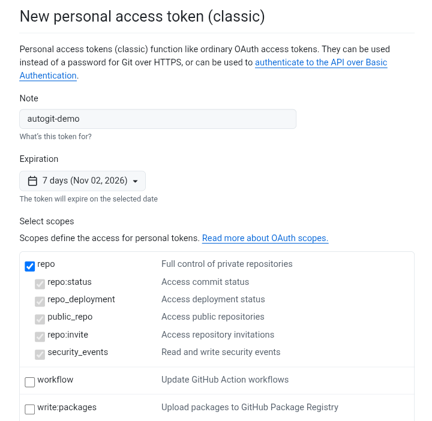

<div align="center">

# autogit

**Push a folder to GitHub, or clone any repository, with one command.**<br>
Two small Bash tools with a clean, guided terminal interface. Built for Termux on Android, and written to run on Linux, macOS and Windows as well.

[](https://github.com/smrafiu/autogit/actions/workflows/ci.yml)
[](LICENSE)
[](https://github.com/smrafiu/autogit/releases)


<br>

&nbsp;&nbsp;&nbsp;

</div>

<br>

## Contents

- [Why autogit](#why-autogit)
- [Quick start](#quick-start)
- [Requirements](#requirements)
- [autopush](#autopush)
- [autoclone](#autoclone)
- [Create an access token](#create-an-access-token)
- [Automation](#automation)
- [Security](#security)
- [What it changes on your device](#what-it-changes-on-your-device)
- [Platform support](#platform-support)
- [Troubleshooting](#troubleshooting)
- [Contributing](#contributing)
- [License](#license)

<br>

## Why autogit

Working from a phone, a git client is awkward: long commands, tokens pasted into URLs, and large clones that fail halfway. autogit wraps plain `git` in a short guided flow so that the whole job takes a minute.

| | |
| --- | --- |
| **One command** | Run it straight from GitHub. Nothing to download, install or configure. |
| **Guided** | Every value is asked for once, validated on the spot, and shown as a single line with a green tick. |
| **Safe with tokens** | Your token is masked while you type, kept in memory only, and never written to disk, to a git config or to a command line. |
| **Fine-grained or classic** | Works with both kinds of GitHub personal access token. |
| **Reliable on mobile data** | Clones use the official `git clone`, retry automatically when the connection drops, and never overwrite an existing folder. |
| **Scriptable** | Every prompt has a flag, so the same tools run unattended in scripts and CI. |
| **Plain Bash** | Two readable files. No dependencies beyond `git` and `curl`. Easy to fork and customize. |

<br>

## Quick start

Push a folder:

```sh
curl -fsSL https://raw.githubusercontent.com/smrafiu/autogit/main/autopush.sh | bash
```

Clone a repository:

```sh
curl -fsSL https://raw.githubusercontent.com/smrafiu/autogit/main/autoclone.sh | bash
```

That is all. The script asks for what it needs and shows the result when it is done. Your token is typed into the prompt, never into the command.

> **Prefer to read the script first?** Good idea. Download it, look at it, then run it:
>
> ```sh
> curl -fsSLO https://raw.githubusercontent.com/smrafiu/autogit/main/autopush.sh
> bash autopush.sh
> ```
>
> To lock the command to a fixed version, replace `main` in the URL with a release tag such as `v1.0.0`.

<br>

## Requirements

- **Bash 3.2 or newer** (every current system has it).
- **git** and **curl**. On Termux, both are installed for you on the first run.
- **A GitHub account.** For pushing, and for cloning private repositories, you also need a [personal access token](#create-an-access-token). Cloning a public repository needs no token.

New to Termux? Install it from [F-Droid](https://f-droid.org/packages/com.termux/) or from the [Termux GitHub releases](https://github.com/termux/termux-app/releases), because the Play Store build is no longer maintained.

<br>

## autopush

Pushes a local folder to a GitHub repository. It initializes git when the folder is not a repository yet, commits everything, and pushes.

### What it asks

| Step | Prompt | Notes |
| --- | --- | --- |
| 1 | **Use this folder?** | Only asked when you start it inside a folder. Answer `n` to type another path. |
| 1 | **Folder Path** | The folder to push. |
| 1 | **Repo URL** | `https://github.com/owner/repo`. An existing remote is offered for reuse. |
| 1 | **Commit Message** | Optional. Defaults to `Update` plus the date and time. |
| 1 | **Description** | Optional. Added to the commit body. |
| 1 | **Access Token** | Masked while you type. |

You then watch the progress and get a summary with the repository, branch, commit, number of files and the time it took.

### Good to know

- Everything in the folder is committed, as with `git add -A`. Files listed in your `.gitignore` are skipped.
- It never force-pushes. When the repository already holds commits that your folder does not have, the push is refused and you are told why.
- Commits are made with your GitHub account name and its `noreply` email address, so your private email is not published.
- Before anything is pushed, the token, the repository and your write access are checked, so a problem stops the run early with a clear `Error` and `Reason`.

### Options

```text
--folder PATH     folder to push
--repo URL        https://github.com/owner/repo
--message TEXT    commit message
--desc TEXT       commit description
--token-stdin     read the token from stdin
--yes             never prompt
--no-color        plain output
--version, --help
```

Pass options through the one-line command with `bash -s --`:

```sh
curl -fsSL https://raw.githubusercontent.com/smrafiu/autogit/main/autopush.sh | bash -s -- --folder ~/site --repo https://github.com/you/site --message "Update"
```

<br>

## autoclone

Clones a public or a private repository into a folder of your choice.

### What it asks

| Step | Prompt | Notes |
| --- | --- | --- |
| 1 | **Use this folder?** | Only asked when you start it inside a folder. Answer `n` to type another path. |
| 1 | **Folder Path** | The folder to clone into. The repository gets its own subfolder named after it. |
| 1 | **Repo URL** | `https://github.com/owner/repo` or just `owner/repo`. |
| 1 | **Access Token** | Asked **only** when the repository is private. |

The tool checks whether the repository is public first, so public repositories are cloned straight away without a token.

### Good to know

- **Fast by default.** Only the latest commit is downloaded (`--depth 1`). Add `--full` for the complete history and all branches.
- **Large repositories.** Downloads that are interrupted by a weak connection are retried up to four times before the tool gives up.
- **Safe to run again.** An existing folder is never overwritten. The clone goes to `name-2`, `name-3` and so on. An empty folder is reused.
- **Clean cancel.** Press `Ctrl-C` to stop, and the half-finished folder is removed.

### Options

```text
--folder PATH     destination folder (default: current folder)
--repo URL        https://github.com/owner/repo or owner/repo
--full            entire history and all branches (default: latest commit)
--token-stdin     read the token from stdin (private repositories)
--yes             never prompt
--no-color        plain output
--version, --help
```

```sh
curl -fsSL https://raw.githubusercontent.com/smrafiu/autogit/main/autoclone.sh | bash -s -- --repo octocat/Hello-World --full
```

<br>

## Create an access token

GitHub needs a token to let a tool push to your repositories (and to read private ones). You can use either kind. Open the page on your phone with **Desktop site** switched on in your browser menu, because it makes the form much easier to read.

> A token is a password. Give it the smallest access that works, set a short expiry, and never share it or post it in an issue.

### Option A: Fine-grained token (recommended)

Limited to the repositories you pick.

1. Open [github.com/settings/personal-access-tokens/new](https://github.com/settings/personal-access-tokens/new). You can also reach it through **Settings → Developer settings → Personal access tokens → Fine-grained tokens → Generate new token**.
2. Enter a **Token name** and choose an **Expiration**.
3. Under **Repository access**, choose **Only select repositories** and pick the repository.
4. Under **Permissions → Repository permissions**, set **Contents** to:
   - **Read and write** to push with `autopush`
   - **Read-only** to clone with `autoclone`

   **Metadata: Read-only** is required and is added for you.
5. Press **Generate token** and copy it right away. GitHub shows it only once.

<p align="center">
  
</p>

### Option B: Classic token

Simpler, but it covers all of your repositories.

1. Open [github.com/settings/tokens/new](https://github.com/settings/tokens/new). You can also reach it through **Settings → Developer settings → Personal access tokens → Tokens (classic) → Generate new token → Generate new token (classic)**.
2. Enter a **Note** and choose an **Expiration**.
3. Under **Select scopes**, tick **repo**. Its sub-options are ticked automatically.
4. Press **Generate token** and copy it right away.

<p align="center">
  
</p>

> To push files under `.github/workflows/`, a classic token also needs the **workflow** scope.

### Which one should I use?

| | Fine-grained | Classic |
| --- | --- | --- |
| Limited to chosen repositories | Yes | No |
| Push | Contents: Read and write | `repo` |
| Clone a private repository | Contents: Read-only | `repo` |
| Best for | Everyday use | A quick start |

<br>

## Automation

Both tools run without any prompt when every value is supplied. Download the script, then pass the token through an environment variable or through standard input. Do not put a token in the command itself.

```sh
curl -fsSLO https://raw.githubusercontent.com/smrafiu/autogit/main/autopush.sh
```

With an environment variable (`AUTOPUSH_TOKEN` for `autopush`, `AUTOCLONE_TOKEN` for `autoclone`):

```sh
export AUTOPUSH_TOKEN
bash autopush.sh --yes --no-color --folder ./site --repo https://github.com/you/site --message "Deploy"
```

With standard input:

```sh
printf '%s' "$SECRET" | bash autopush.sh --yes --token-stdin --folder ./site --repo https://github.com/you/site
```

Exit codes:

| Code | Meaning |
| --- | --- |
| `0` | Success |
| `1` | The push, the clone or GitHub reported a failure |
| `2` | Bad input, a missing or invalid token, or a missing tool |

<br>

## Security

- The token is read from a masked prompt, an environment variable or standard input. There is deliberately no `--token` flag, because command-line arguments are visible to other processes.
- It is held in memory for the run only. It is never saved to a file, a git config or the remote URL.
- Git receives it through a credential helper, so it does not appear in `ps` output. Error text is scrubbed of the token before it is displayed.
- The scripts are short and readable. Read them before you run them.

To report a vulnerability, see [SECURITY.md](SECURITY.md).

<br>

## What it changes on your device

autogit keeps its footprint small, and here is all of it.

| Script | Change |
| --- | --- |
| both | On Termux only: installs `git` and `curl` on the first run, and requests storage access with `termux-setup-storage` when it is missing. |
| `autopush` | Adds `safe.directory = *` to your global git config, so git accepts folders on shared storage that belong to another user ID. |
| `autopush` | In the pushed folder: runs `git init` if needed, sets `user.name` and `user.email` for that repository only, and sets `origin`. |
| `autoclone` | Creates the destination folder. |

<br>

## Platform support

| Platform | Status |
| --- | --- |
| Termux on Android | Primary target. Developed and tested here. |
| Linux | Supported. Syntax and lint checks run in CI. |
| macOS | Written for the system Bash 3.2. The scripts load in CI on macOS. |
| Windows | Use Git Bash or WSL. The scripts load in CI on Windows. |

CI checks syntax, lint and `--help` on each platform. The full interactive flow has been exercised on Termux. If you hit a problem elsewhere, please [open an issue](https://github.com/smrafiu/autogit/issues/new/choose).

<br>

## Troubleshooting

| Message | What to do |
| --- | --- |
| **Cannot reach GitHub** | Check your connection and try again. |
| **Repository not found** | Check the URL. For a private repository, the token must be allowed to access it. |
| **Token cannot access this repository** | The token has expired or lacks access to this repository. Create a new one. |
| **No write access** | Give the token **Contents: Read and write** (fine-grained) or the **repo** scope (classic). |
| **The repository already has commits that this folder does not have** | The push was refused so nothing is overwritten. Clone the repository first and copy your files in, or push to an empty repository. |
| **The branch is protected** | The repository only accepts changes through pull requests. |
| **A file is larger than the 100 MB limit of GitHub** | Remove or ignore the large file, then run again. |
| **The token needs the 'workflow' scope** | Add the `workflow` scope to a classic token. |
| **The connection was interrupted** | Try again on a stronger network. `autoclone` already retried several times. |
| **Not enough storage space** | Free some space on the device. |

<br>

## Contributing

Bug reports, ideas and pull requests are welcome. Please read [CONTRIBUTING.md](CONTRIBUTING.md) first, and follow the [Code of Conduct](CODE_OF_CONDUCT.md). See the [changelog](CHANGELOG.md) for what changed in each release.

<br>

## License

Released under the [MIT License](LICENSE). Copyright (c) 2026 S. M. Rafiu.
